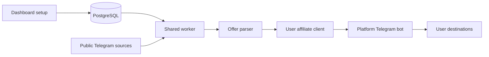

# Telegram Offers Bot

Multi-tenant offers automation. Shared worker polls configured public Telegram sources, extracts supported product links, generates each user's affiliate links, and posts through platform bot to that user's enabled destinations.

## Runtime architecture



- Dashboard saves `source_chats`, destinations, and Amazon/Shopee/Mercado Livre/AliExpress credentials in PostgreSQL.
- Worker reloads persisted config every 30 seconds.
- Every public source is fetched once per cycle, then messages are fanned out to subscribed users.
- Real Telegram post IDs plus PostgreSQL records provide per-user deduplication.
- Destination posting uses one platform bot. Users do not create their own bots or Telegram sessions.

## Parsing

DeepSeek v4 Flash through LiteLLM is primary structured parser. Gemini 2.5 Flash Lite is fallback. Regex parser runs when AI credentials are absent or AI parsing fails.

URL routing and affiliate conversion support:

- Mercado Livre
- Amazon Brazil
- Shopee Brazil
- AliExpress

## Setup

1. Create platform bot with `@BotFather` and copy token.
2. Copy `.env.example` to `.env` and set platform infrastructure/auth secrets. User settings and affiliate credentials do not belong in `.env`.
3. Start stack:

```powershell
docker compose up --build
```

4. Register/login in frontend.
5. Complete dashboard setup:

   - add platform bot to destination group/channel;
   - grant bot permission to post messages and photos;
   - save destination chat ID;
   - save credentials for one or more affiliate providers;
   - select public Telegram source groups.

Worker begins processing after next 30-second refresh.

## Configuration boundaries

User-owned business configuration is stored only in PostgreSQL through authenticated `/users/me` endpoints:

- destination chat IDs and enabled state;
- selected source chats;
- affiliate tags, API keys, cookies, CSRF tokens, and tracking IDs;
- optional browser resolver settings if later exposed by dashboard/API.

`.env` contains platform infrastructure only:

- shared `TELEGRAM_BOT_TOKEN`;
- database/auth/OAuth secrets;
- optional shared AI parser credentials.

Old `TELEGRAM_API_ID`, `TELEGRAM_API_HASH`, `SOURCE_CHATS`, `TARGET_CHAT`, affiliate keys, and browser settings are not worker runtime inputs anymore.

## Provider credentials

### Mercado Livre

Save affiliate tag, authenticated cookie header, and CSRF token in dashboard. Cookies expire; update provider config when API begins returning 401/403.

### Amazon

Save Associates tag, authenticated cookie header, and optional marketplace ID. Default marketplace ID is `526970`.

### Shopee

Save Affiliate Open Platform app ID and app secret.

### AliExpress

Save Affiliate API app key, app secret, and optional tracking ID.

## Local quality checks

Use project virtual environment:

```powershell
.\venv\Scripts\ruff.exe format .
.\venv\Scripts\ruff.exe check --fix .
.\venv\Scripts\python.exe -m unittest discover tests
```

## Troubleshooting

- Destination save fails: confirm platform bot is administrator and can post messages/photos.
- User stays inactive: confirm enabled destination, at least one complete affiliate provider, and saved source selection all exist.
- Source returns no messages: shared poller supports public `t.me` groups/channels only, not private invite links.
- New config is not active: allow one 30-second worker cycle.
- AI keys missing: regex parsing continues automatically.
