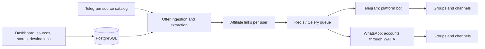

# Offers Bot

A multi-tenant platform for collecting offers, generating affiliate links, and
publishing to **Telegram and WhatsApp groups and channels**.

Each user configures their stores, sources, destinations, and categories through
the web dashboard. The platform monitors a shared catalog of Telegram sources
and distributes offers to enabled destinations, with expiration, deduplication,
and delivery history. WhatsApp supports multiple accounts through WAHA, with
publication controls per account and destination.

## Features

- **Web dashboard:** guided setup, integrations, destinations, and searchable history.
- **Five stores:** Amazon Brazil, Mercado Livre, Shopee Brazil, AliExpress, and KaBuM!.
- **Telegram:** publishing through a platform-owned bot to authorized groups and channels.
- **WhatsApp:** QR pairing, multiple accounts, groups and administered channels,
  group creation, and publication controls.
- **Processing:** AI extraction with fallback, user-specific affiliate links,
  category routing, and reuse of source media.
- **Operations:** posting queue, offer expiration, failure handling, and encrypted
  user credentials in PostgreSQL.

## How it works

**Sources and destinations are independent:** offers currently originate from
Telegram, even when a user publishes exclusively to WhatsApp. Users do not need
to create a bot or authenticate a Telegram reader account.

## Documentation

The [documentation index](docs/README.md) organizes guides by task.

| I want to… | Guide |
| --- | --- |
| Use the dashboard and configure publishing | [User guide](docs/user-guide.md) |
| Run the platform locally | [Local setup](docs/local-setup.md) |
| Deploy to production with Coolify | [Deployment](docs/deploy.md) |
| Understand environment variables and secrets | [Configuration](docs/configuration.md) |
| Configure stores and AI extraction | [Integrations](docs/integrations.md) |
| Connect and operate WhatsApp accounts | [WhatsApp and WAHA](docs/whatsapp.md) |
| Understand services and data flow | [Architecture](docs/architecture.md) |
| Administer, monitor, and troubleshoot | [Operations](docs/operations.md) |
| Configure authentication and encryption | [Security](docs/security.md) |
| Develop and validate changes | [Development](docs/development.md) |
| Upgrade an older installation | [Migrations and legacy](docs/migrations.md) |

## Getting started

For a new installation, follow [Local setup](docs/local-setup.md) or
[Deployment](docs/deploy.md). Both cover the database, secrets, authentication,
and first login before configuring sources, stores, and destinations in the dashboard.

The main runtime uses Next.js, FastAPI, PostgreSQL, Telethon, Redis, and Celery.
WAHA is an external service required for WhatsApp publishing. The older standalone
bot remains available for compatibility and is documented separately under
[Migrations and legacy](docs/migrations.md).
