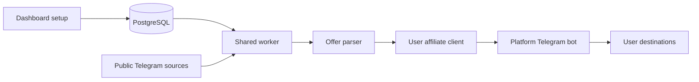

# Telegram Offers Bot

Multi-tenant offers automation. Shared worker listens to the platform Telegram source catalog through Telethon, extracts supported product links, generates each user's affiliate links, and posts through platform bot to that user's enabled destinations.

## Runtime architecture



- Dashboard saves `source_chats`, destinations, and Amazon/Shopee/Mercado Livre/AliExpress credentials in PostgreSQL.
- Worker reloads persisted config every 30 seconds.
- One operator-owned Telethon account receives catalog messages and fans them out to subscribed users. Users select catalog groups and cannot add their own sources.
- Real Telegram post IDs plus PostgreSQL records provide per-user deduplication.
- Destination posting uses one platform bot. Users do not create their own bots or Telegram sessions.

## Parsing

Qwen 3.7 Flash (`qwen/qwen3.7-flash`) through OpenRouter is the primary structured parser. DeepSeek V4 Flash and Gemini 2.5 Flash Lite use direct provider APIs as fallbacks. Regex parser runs when AI credentials are absent or AI parsing fails.

URL routing and affiliate conversion support:

- Mercado Livre
- Amazon Brazil
- Shopee Brazil
- AliExpress

## Setup

1. Create platform bot with `@BotFather` and copy token.
2. Copy `.env.example` to `.env` and set platform infrastructure/auth secrets. User settings and affiliate credentials do not belong in `.env`.
3. Start stack:

```powershell
docker compose up --build
```

4. Register/login in frontend.
5. Complete dashboard setup:

   - add platform bot to destination group/channel;
   - grant bot permission to post messages and photos;
   - save destination chat ID;
   - save credentials for one or more affiliate providers;
   - select Telegram source groups from the platform catalog.

Worker begins processing after next 30-second refresh.

## Database migrations

Backend runs `alembic upgrade head` during startup.

Run migrations manually from repository root with project virtual environment:

```powershell
.\venv\Scripts\alembic.exe -c backend\alembic.ini upgrade head
```

## Configuration boundaries

User-owned business configuration is stored only in PostgreSQL through authenticated `/users/me` endpoints:

- destination chat IDs and enabled state;
- selected source chats;
- affiliate tags, API keys, cookies, CSRF tokens, and tracking IDs;
- optional browser resolver settings if later exposed by dashboard/API.

`.env` contains platform infrastructure only:

- shared `TELEGRAM_BOT_TOKEN`;
- database/auth/OAuth secrets;
- optional shared AI parser credentials.

The operator reader uses `TELEGRAM_API_ID`, `TELEGRAM_API_HASH`, and its shared session/QR settings. `SOURCE_CHATS`, `TARGET_CHAT`, and affiliate environment variables are legacy CLI settings; the shared worker takes catalog subscriptions, destinations, and affiliate settings from PostgreSQL.

## Provider credentials

### Mercado Livre

Save affiliate tag, authenticated cookie header, and CSRF token in dashboard. Cookies expire; update provider config when API begins returning 401/403.

### Amazon

Save Associates tag, authenticated cookie header, and optional marketplace ID. Default marketplace ID is `526970`.

### Shopee

Save Affiliate Open Platform app ID and app secret.

### AliExpress

Save Affiliate API app key, app secret, and optional tracking ID.

## Local quality checks

### Pre-commit automático

Instale as ferramentas de desenvolvimento e ative o hook uma vez por clone:

```powershell
.\venv\Scripts\python.exe -m pip install -r requirements-dev.txt
npm --prefix frontend ci
.\venv\Scripts\python.exe -m pre_commit install --install-hooks
```

Antes de cada commit, Ruff corrige e formata o Python; ESLint verifica todo o frontend com correções automáticas e `--max-warnings 0`. Todos os hooks rodam mesmo se o commit não alterar arquivos Python ou JavaScript. Se houver correções, o commit é interrompido: revise o diff, adicione os arquivos corrigidos e tente novamente. Erros e warnings restantes bloqueiam o commit. O hook não adiciona arquivos ao índice automaticamente.

Para executar a mesma verificação manualmente:

```powershell
.\venv\Scripts\python.exe -m pre_commit run --all-files
npm --prefix frontend run lint:fix
```

Ruff remove `noqa` desnecessário com `RUF100` e o hook usa `--ignore-noqa`, para que essas anotações não escondam erros. ESLint não aceita comentários para desativar regras. Corrija a causa do diagnóstico; não esconda o problema com supressões ou desativando regras. Os testes continuam sendo executados antes de cada commit, conforme `AGENTS.md`.

Use project virtual environment:

```powershell
.\venv\Scripts\ruff.exe format .
.\venv\Scripts\ruff.exe check --fix .
.\venv\Scripts\python.exe -m unittest discover tests
```

## Troubleshooting

- Destination save fails: confirm platform bot is administrator and can post messages/photos.
- User stays inactive: confirm enabled destination, at least one complete affiliate provider, and saved source selection all exist.
- Source returns no messages: check the operator Telethon account can access every catalog group.
- New config is not active: allow one 30-second worker cycle.
- AI keys missing: regex parsing continues automatically.

### Shared Telegram reader

Set `TELEGRAM_API_ID` and `TELEGRAM_API_HASH` for the operator account. Supply `TELEGRAM_SESSION_STRING` or set `TELEGRAM_PHONE` and scan the QR served on port 8081. Operator sessions, LLM accounting, catalog sources, user destinations and affiliate credentials are persisted in PostgreSQL. Docker mounts `data` for temporary media and legacy import files. Set `OPENROUTER_API_KEY` to enable the primary Qwen parser.

### Migração da persistência da plataforma

Configure `DATABASE_URL` conforme `.env.example`. A porta local padrão é 5434;
dentro do Docker, os serviços usam `db:5432`. Instale as dependências atualizadas.
O backend aplica a migração `0005_platform_persistence` ao iniciar.

Para importar sessão do operador e histórico de tokens de uma instalação anterior,
pare o worker e execute, com o banco e o backend disponíveis:

```powershell
docker compose up -d db backend
.\venv\Scripts\python.exe -m backend.import_sqlite data/offers.sqlite3
docker compose up -d worker
```

A importação é transacional e pode ser repetida usando o mesmo arquivo. Não altera
o SQLite nem sobrescreve sessões já existentes no PostgreSQL. Os IDs de origem
identificam um único banco legado; não use esse comando para combinar arquivos
SQLite independentes. Ofertas do bot antigo não são importadas: sua deduplicação
global não identifica o usuário exigido pelo modelo da plataforma.

O bot legado executado separadamente continua compatível com SQLite. A plataforma
usa PostgreSQL; `DATABASE_PATH` serve apenas ao modo legado e à importação.

### Administrator access and source catalog

The `/admin/source-groups` screen and every `/admin/source-groups` API operation require the `admin` role. The API checks the current database role on every request; changing or revoking a role applies even to existing tokens. Public registration always creates a `user` account.

Apply migration `0004_admin_source_catalog` (automatically on backend startup). It gives existing users the `user` role and seeds the seven original Telegram sources once. Register your administrator account, then promote it through trusted operator access:

```powershell
.\venv\Scripts\python.exe -m backend.set_admin admin@example.com
# Revoke administrator access:
.\venv\Scripts\python.exe -m backend.set_admin admin@example.com --role user
```

With Docker, run `docker compose exec backend python -m backend.set_admin admin@example.com` after the account is registered. No public API grants administrator roles.

Administrators can add, edit, enable, disable, and remove public Telegram groups. Only enabled groups are selectable by users and accepted by configuration endpoints. The shared Telethon reader refreshes catalog changes every 30 seconds without restarting; removed or disabled groups stop delivering offers. Saved selections for unavailable groups stay stored but inactive until the group becomes available again. An empty catalog disables all sources. The operator Telegram account must be able to join/read each source.
