# Architecture

[Documentation index](README.md)

## Overview

The platform has a configuration layer and an asynchronous offer pipeline.
The dashboard and API persist settings in PostgreSQL; a shared reader ingests
messages, and queue consumers publish to each user's destinations.

```mermaid
flowchart TD
    U[User] --> F[Next.js frontend / Better Auth]
    F --> API[FastAPI API]
    F --> DB[(PostgreSQL)]
    API --> DB
    S[Public Telegram catalog] --> R[Worker / Telethon]
    DB --> R
    R --> P[AI / regex parser]
    P --> A[Affiliate clients per user]
    A --> Q[(Redis: promotions queue)]
    Q --> C[Posting / Celery]
    C --> DB
    C --> T[Telegram Bot API]
    C --> H[External WAHA]
    H --> WA[User WhatsApp accounts]
```

## Components

| Component | Responsibility |
| --- | --- |
| `frontend` | Next.js dashboard, Better Auth authentication, and authenticated API proxy |
| `backend` | FastAPI API, authorization, settings, destinations, integrations, and migrations |
| `worker` | Telethon reader account, configuration refresh, offer extraction, and preparation |
| `posting` | Celery consumer: final eligibility checks, delivery policies, publishing, and audit records |
| PostgreSQL | Users, sessions, catalog, encrypted settings, deduplication, and history |
| Redis | Temporary task transport; neither the history store nor a persistent queue |
| WAHA | WhatsApp sessions and discovery, management, and send calls; provisioned separately |

## Offer lifecycle

1. The operator's Telegram account receives messages from catalog groups.
2. The worker identifies users subscribed to that source and extracts supported offers.
3. The parser interprets products, prices, coupons, and categories. Regex extraction
   remains available when AI providers are missing or fail.
4. Each user receives links generated with their own affiliate credentials.
5. Destinations and categories are evaluated; conversion failures are recorded per
   destination before any send.
6. Individual tasks enter the Redis `promotions` queue.
7. The consumer rechecks destination, category, validity, and, for WhatsApp, the
   responsible connection and policy. It publishes through the Telegram bot or
   that WhatsApp account.
8. Results are persisted and displayed in the user's authenticated history.

The worker reloads the catalog and user settings every 30 seconds. Changes do
not automatically reprocess old offers.

## Isolation and ownership

- The platform administers the catalog. Users select enabled sources; they cannot
  register their own sources.
- Telegram ingestion uses an operator-owned account. Telegram publishing uses a
  shared bot authorized in each destination.
- Affiliate tags, keys, and cookies belong to users and are encrypted in
  `user_configs.config_data`.
- Each WhatsApp connection has its own session, limits, and operational state.
  The server derives its session from the authenticated identity and owned connection.
- Destinations and history records are owner-scoped. Administrative permissions
  are checked against the database on each request.
- WhatsApp spacing, quota, and pause policies do not apply to Telegram.
  Both platforms respect the operator's offer validity ceiling.

## Validity, deduplication, and delivery

The maximum lifetime is **600 seconds**, counted from the original message,
including parsing, conversion, queueing, and attempts. Retries do not renew the
deadline. `PROMOTION_TTL_SECONDS` can shorten it, never extend it.

Deduplication uses product identifiers and PostgreSQL records. On WhatsApp,
the policy also coordinates product/variation and price per destination within
a 30-minute window; price changes allow a new publication. Transactional locks
coordinate reservations across concurrent consumers.

The system avoids automatic resends when the outcome is uncertain. A redelivered
broker task must not repeat a send that has already started. These measures do
not constitute an exactly-once delivery guarantee.

See [queue operations](operations.md), [WhatsApp](whatsapp.md), and the
[technical specification](whatsapp-implementation.md).

## Repository layout

| Path | Contents |
| --- | --- |
| `frontend/` | Next.js routes, dashboard features, and authentication |
| `backend/app/` | API, models, domain rules, and security |
| `backend/worker/` | Shared reader, persistence, and posting consumers |
| `backend/alembic/` | PostgreSQL migrations |
| `offers_bot/` | Parsing, formatting, and affiliate clients reused by the worker |
| `tests/` | Domain tests, mocked integrations, and concurrency tests |
| `docs/` | Product and operational documentation |
| `data/` | Temporary media and import/compatibility files |

The older standalone runtime is separate from the multi-tenant pipeline. Read
[Migrations and legacy](migrations.md) before using `run.py` or SQLite settings.
